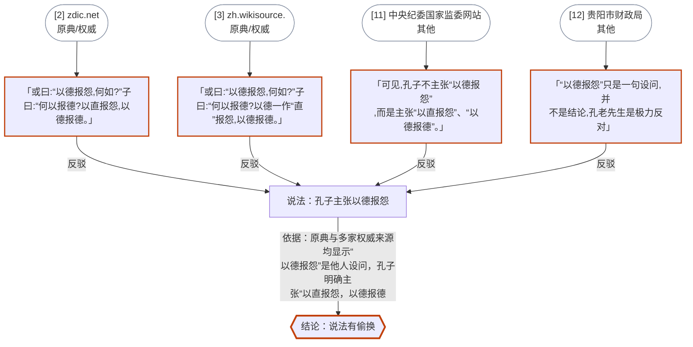

# 查证报告：孔子主张以德报怨

- 时间：2026/10/24 18:03:33
- 作品：论语
- 要核实：核实“孔子主张以德报怨”是否为误传：孔子在《论语·宪问》中实际主张“以直报怨，以德报德”，“以德报怨”是他人（或曰）提出的说法。

## 结论：说法有偷换
孔子并不主张以德报怨。《论语·宪问》原文是别人问“以德报怨，何如”，孔子反问“何以报德”，并主张“以直报怨，以德报德”[2][3][11]。把提问当成孔子主张，属误传。

> “以德报怨”是否源于《老子》仅有百科提及[6]，未据原典核实。

## 证据（模型引用的原句，已逐字核对；编号对应文末来源列表）
- [2]【反驳】「或曰:“以德报怨,何如?”子曰:“何以报德?以直报怨,以德报德。」 —— [zdic.net](https://zdic.net/hans/%E4%BB%A5%E5%BE%B7%E5%A0%B1%E6%80%A8)
- [3]【反驳】「或曰:“以德报怨,何如?”子曰:“何以报德?以德一作“直”报怨,以德报德。」 —— [zh.wikisource.org](https://zh.wikisource.org/zh-hans/%E8%AB%96%E8%AA%9E/%E6%86%B2%E5%95%8F%E7%AC%AC%E5%8D%81%E5%9B%9B)
- [11]【反驳】「可见,孔子不主张“以德报怨”,而是主张“以直报怨”、“以德报德”。」 —— [中央纪委国家监委网站](https://m.ccdi.gov.cn/content/45/bc/3189.html)
- [12]【反驳】「“以德报怨”只是一句设问,并不是结论,孔老先生是极力反对」 —— [贵阳市财政局](https://czj.guiyang.gov.cn/new_site/xwdt/zhdt_5908367/202205/t20220531_74506472.html)

## 论证图


## 调查步骤
- 细节词：以德报怨、以直报怨、以德报德、何以报德、宪问、或曰、子曰、报怨
- 元宝搜索「孔子 以德报怨 原文 出处 论语 宪问」：20 条
- 元宝搜索「以德报怨 以直报怨 以德报德 何以报德 原文」：20 条
- 元宝搜索「以德报怨 误传 不是孔子 老子 出处」：20 条
- 元宝搜索「论语 宪问 或曰 以德报怨 子曰 何以报德」：20 条
- 元宝搜索「论语 孔子主张以德报怨」：20 条
- 元宝搜索「论语 以德报怨 宪问」（站内：zh.wikisource.org）：10 条
- 元宝搜索「论语 以德报怨 宪问」（站内：ctext.org）：10 条
- 元宝搜索「论语 以德报怨 宪问」（站内：zdic.net）：5 条
- 元宝搜索「论语 以德报怨 宪问」（站内：piyao.org.cn）：0 条
- 共 85 个网页，69 个提到细节

## 提到细节的全部来源
1. [老子劝人立德](http://sspress.cssn.cn/2009n/12y/3_28354/d20b_28374/201508/t20150826_2652957.shtml) · 官方 · 中国社会科学网
2. [以德報怨的解释汉典](https://zdic.net/hans/%E4%BB%A5%E5%BE%B7%E5%A0%B1%E6%80%A8) · 官方 · zdic.net
3. [论语/宪问第十四](https://zh.wikisource.org/zh-hans/%E8%AB%96%E8%AA%9E/%E6%86%B2%E5%95%8F%E7%AC%AC%E5%8D%81%E5%9B%9B) · 官方 · zh.wikisource.org
4. [论语选译 Lunjy syanji.pdf/29](https://zh.wikisource.org/zh-hans/Page:%E8%AB%96%E8%AA%9E%E9%81%B8%E8%AD%AF_Lunjy_syanji.pdf/29) · 官方 · zh.wikisource.org
5. [何以 词语解释](https://zdic.net/hans/%E4%BD%95%E4%BB%A5) · 官方 · zdic.net
6. [常言道:以德报怨,但孔子却并不认同这句话](https://baike.baidu.com/tashuo/browse/content?id=9b9d9c1a668d5835d8269e87) · 百科 · 百度百科
7. [以德报怨 - 汉语成语](https://baike.so.com/doc/10040027-32363474.html) · 百科 · 360百科
8. [以德报怨](https://baike.so.com/doc/10040027.html) · 百科 · 360百科
9. [君子之交,淡而不腻,始得长久](https://m.news.cctv.com/2018/09/28/ARTIo47hUK2tZNNzP9lIUW5E180928.shtml) · 媒体 · 央视新闻
10. [中国古人何以报怨?盘点古籍概括的3大方式](https://www.chinanews.com.cn/hb/news/2009/09-27/1889477.shtml) · 媒体 · 中国新闻网
11. [孔子对“以德报怨”怎么看?](https://m.ccdi.gov.cn/content/45/bc/3189.html) · 其他 · 中央纪委国家监委网站
12. [这些耳熟能详的《论语》名言,原来另有其意](https://czj.guiyang.gov.cn/new_site/xwdt/zhdt_5908367/202205/t20220531_74506472.html) · 其他 · 贵阳市财政局
13. [【微也足道】孔子对“以德报怨”怎么看?](https://sdjj.gov.cn/szzx/201505/t20150515_11226177.htm) · 其他 · 山东省纪委监委网站
14. [以德报怨](https://www.chinanews.com.cn/hb/2011/07-13/3180327.shtml) · 媒体 · 中国新闻网

## ClaimReview（schema.org 事实核查标准格式）
```json
{
 "@context": "https://schema.org",
 "@type": "ClaimReview",
 "datePublished": "2026-10-24",
 "claimReviewed": "孔子主张以德报怨",
 "author": {
  "@type": "Organization",
  "name": "元宝考据侦探"
 },
 "reviewRating": {
  "@type": "Rating",
  "alternateName": "说法有偷换"
 },
 "itemReviewed": {
  "@type": "Claim",
  "appearance": [
   {
    "@type": "CreativeWork",
    "url": "https://zdic.net/hans/%E4%BB%A5%E5%BE%B7%E5%A0%B1%E6%80%A8"
   },
   {
    "@type": "CreativeWork",
    "url": "https://zh.wikisource.org/zh-hans/%E8%AB%96%E8%AA%9E/%E6%86%B2%E5%95%8F%E7%AC%AC%E5%8D%81%E5%9B%9B"
   },
   {
    "@type": "CreativeWork",
    "url": "https://m.ccdi.gov.cn/content/45/bc/3189.html"
   },
   {
    "@type": "CreativeWork",
    "url": "https://czj.guiyang.gov.cn/new_site/xwdt/zhdt_5908367/202205/t20220531_74506472.html"
   }
  ]
 }
}
```