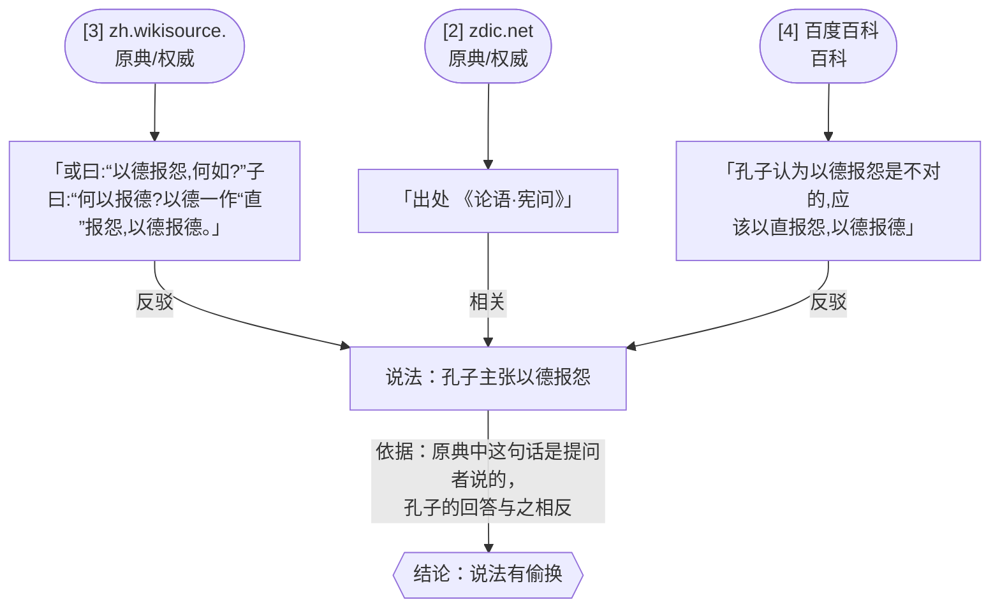

# 查证报告：孔子主张以德报怨

| 评级 | 说法有偷换 ●●○○○ |
|---|---|
| 领域 | 名言·文史 |
| 类型 | 说法（核实真假） |
| 相关 | 论语 |
| 搜索轮次 | 2 轮 |
| 搜索来源 | 元宝搜索 API（回放 2026-10-24 18:03 的真实结果） |
| 查证时间 | 2026-10-24 20:37 |

## 结论
孔子并不主张以德报怨。《论语·宪问》里这句话是别人问孔子的，孔子反问“何以报德”，主张“以直报怨，以德报德”[2][3]。

## 拆开来看

**原文能证实的**
- “以德报怨”一词出自《论语·宪问》中他人的提问 [2][3]

**原文不支持的**
- 孔子主张以德报怨 [3][6]

**没查到的**
- “以德报怨”最早是否出自《老子》

## 证据清单

| 来源 | 原句 | 立场 | 网站 | 核对 |
|---|---|---|---|---|
| [3](https://zh.wikisource.org/zh-hans/%E8%AB%96%E8%AA%9E/%E6%86%B2%E5%95%8F%E7%AC%AC%E5%8D%81%E5%9B%9B) | 「或曰:“以德报怨,何如?”子曰:“何以报德?以德一作“直”报怨,以德报德。」 | 反驳 | zh.wikisource.org（原典/权威） | 原文一致 |
| [2](https://zdic.net/hans/%E4%BB%A5%E5%BE%B7%E5%A0%B1%E6%80%A8) | 「出处 《论语·宪问》」 | 相关 | zdic.net（原典/权威） | 原文一致 |
| [4](https://baike.baidu.com/tashuo/browse/content?id=9b9d9c1a668d5835d8269e87) | 「孔子认为以德报怨是不对的,应该以直报怨,以德报德」 | 反驳 | 百度百科（百科） | 原文一致 |

## 论证图



## 调查过程

- 要核实：核实“孔子主张以德报怨”是否为误传：孔子在《论语·宪问》中实际主张“以直报怨，以德报德”，“以德报怨”是他人（或曰）提出的说法。
- 细节词：以德报怨、以直报怨、以德报德、何以报德、宪问、或曰、子曰、报怨、老子、报怨以德
- 第 1 轮（初搜）：按拆解出的搜索词全网搜索，并在权威知识源站内搜索；新增网页 85 个
  - 元宝搜索「孔子 以德报怨 原文 出处 论语 宪问」：20 条
  - 元宝搜索「以德报怨 以直报怨 以德报德 何以报德 原文」：20 条
  - 元宝搜索「以德报怨 误传 不是孔子 老子 出处」：20 条
  - 元宝搜索「论语 宪问 或曰 以德报怨 子曰 何以报德」：20 条
  - 元宝搜索「论语 孔子主张以德报怨」：20 条
  - 元宝搜索「论语 以德报怨 宪问」（站内 zh.wikisource.org）：10 条
  - 元宝搜索「论语 以德报怨 宪问」（站内 ctext.org）：10 条
  - 元宝搜索「论语 以德报怨 宪问」（站内 zdic.net）：5 条
  - 元宝搜索「论语 以德报怨 宪问」（站内 piyao.org.cn）：0 条
- 第 2 轮（顺藤摸瓜）：第一轮原句里出现了《老子》，可能是“以德报怨”的真正出处；新增网页 0 个
  - 元宝搜索「老子 报怨以德 原文」：5 条
- 共 85 个网页，69 个提到细节，取前 14 个交给判断
- 引用 3 句，原文核对通过 3 句

## 来源列表（编号与上文一致）

1. [老子劝人立德](http://sspress.cssn.cn/2009n/12y/3_28354/d20b_28374/201508/t20150826_2652957.shtml) · 原典/权威 · 中国社会科学网
2. [以德報怨的解释汉典](https://zdic.net/hans/%E4%BB%A5%E5%BE%B7%E5%A0%B1%E6%80%A8) · 原典/权威 · zdic.net
3. [论语/宪问第十四](https://zh.wikisource.org/zh-hans/%E8%AB%96%E8%AA%9E/%E6%86%B2%E5%95%8F%E7%AC%AC%E5%8D%81%E5%9B%9B) · 原典/权威 · zh.wikisource.org
4. [常言道:以德报怨,但孔子却并不认同这句话](https://baike.baidu.com/tashuo/browse/content?id=9b9d9c1a668d5835d8269e87) · 百科 · 百度百科
5. [论语选译 Lunjy syanji.pdf/29](https://zh.wikisource.org/zh-hans/Page:%E8%AB%96%E8%AA%9E%E9%81%B8%E8%AD%AF_Lunjy_syanji.pdf/29) · 原典/权威 · zh.wikisource.org
6. [何以 词语解释](https://zdic.net/hans/%E4%BD%95%E4%BB%A5) · 原典/权威 · zdic.net
7. [中国古人何以报怨?盘点古籍概括的3大方式](https://www.chinanews.com.cn/hb/news/2009/09-27/1889477.shtml) · 媒体 · 中国新闻网
8. [以德报怨 - 汉语成语](https://baike.so.com/doc/10040027-32363474.html) · 百科 · 360百科
9. [以德报怨](https://baike.so.com/doc/10040027.html) · 百科 · 360百科
10. [以德报怨](https://www.chinanews.com.cn/hb/2011/07-13/3180327.shtml) · 媒体 · 中国新闻网
11. [君子之交,淡而不腻,始得长久](https://m.news.cctv.com/2018/09/28/ARTIo47hUK2tZNNzP9lIUW5E180928.shtml) · 媒体 · 央视新闻
12. [孔子对“以德报怨”怎么看?](https://m.ccdi.gov.cn/content/45/bc/3189.html) · 媒体 · 中央纪委国家监委网站
13. [这些耳熟能详的《论语》名言,原来另有其意](https://czj.guiyang.gov.cn/new_site/xwdt/zhdt_5908367/202205/t20220531_74506472.html) · 媒体 · 贵阳市财政局
14. [【微也足道】孔子对“以德报怨”怎么看?](https://sdjj.gov.cn/szzx/201505/t20150515_11226177.htm) · 媒体 · 山东省纪委监委网站

<details><summary>ClaimReview（schema.org 事实核查标准格式）</summary>

```json
{
 "@context": "https://schema.org",
 "@type": "ClaimReview",
 "datePublished": "2026-10-24",
 "claimReviewed": "孔子主张以德报怨",
 "author": {
  "@type": "Organization",
  "name": "元宝考据侦探"
 },
 "reviewRating": {
  "@type": "Rating",
  "ratingValue": 2,
  "bestRating": 5,
  "worstRating": 1,
  "alternateName": "说法有偷换"
 },
 "itemReviewed": {
  "@type": "Claim",
  "appearance": [
   {
    "@type": "CreativeWork",
    "url": "https://zh.wikisource.org/zh-hans/%E8%AB%96%E8%AA%9E/%E6%86%B2%E5%95%8F%E7%AC%AC%E5%8D%81%E5%9B%9B"
   },
   {
    "@type": "CreativeWork",
    "url": "https://zdic.net/hans/%E4%BB%A5%E5%BE%B7%E5%A0%B1%E6%80%A8"
   },
   {
    "@type": "CreativeWork",
    "url": "https://baike.baidu.com/tashuo/browse/content?id=9b9d9c1a668d5835d8269e87"
   }
  ]
 }
}
```
</details>
