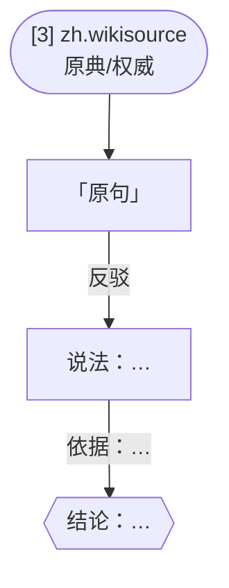

# 报告版式

脚本生成的 `report.md` 就是这个版式；同时会生成一份自包含的 `report.html`（图片直接展示、B 站视频可播放、加载失败可点原图/原链接）。用 MCP 手动出报告时，也照这个版式写。

报告的结构参照 schema.org 的 ClaimReview 事实核查格式（被核查的说法、评级、出处）和 Snopes 的写法（先给评级，再分对的部分和错的部分）。论证图按 Toulmin 论证模型画：来源 → 原句 → 主张 → 依据 → 结论。

````markdown
# 查证报告：{用户原话}

| 评级 | {verdict} ●●○○○ |
|---|---|
| 领域 | 名言·文史 |
| 类型 | 说法（核实真假） |
| 相关 | 论语 |
| 搜索轮次 | 1 轮 |
| 搜索来源 | 元宝搜索 API |
| 查证时间 | 2026-10-24 18:03 |

## 结论
{summary，带 [编号]}

> {caveat；有降级或有引用核对失败时写在这里}

## 拆开来看
**原文能证实的**
- … [2][3]

**原文不支持的**
- … [3]

**没查到的**
- …

## 证据清单
| 来源 | 原句 | 立场 | 网站 | 核对 |
|---|---|---|---|---|
| [3](链接) | 「逐字原句」 | 反驳 | zh.wikisource.org（原典/权威） | 原文一致 |

## 相关图片（有筛选通过的来源页配图时出现）
来自来源网页，仅供参考，不作为查证证据。
- [3] 配图说明 —— [打开原图](图片直链)

## 相关视频（结果里有 B 站相关视频时出现）
B 站相关视频，仅供参考，不作为原片证据。
- [视频标题](https://www.bilibili.com/video/BV…)

## 论证图


## 试过的搜索（只在查不到时出现）
- 第 1 轮：「…」，20 条
- 第 2 轮：「…」，20 条

## 需要你提供的线索（查不到或部分查到时出现）
补充下面任意一条，就能带着线索再查一次：
- 你是在哪里看到这个说法的
- …

## 调查过程
- 要核实：…
- 细节词：…
- 第 1 轮（初搜）：…；新增网页 N 个
  - 元宝搜索「…」：20 条
  - 元宝搜索「…」（站内 zh.wikisource.org）：10 条
- 第 2 轮（顺藤摸瓜）：原句里出现了《…》；新增网页 N 个
- 共 N 个网页，M 个提到细节；引用 K 句，核对通过 K 句

## 来源列表（编号与上文一致）
1. [标题](链接) · 类别 · 站点
````

评级圆点：有出处/查到答案 5 个，部分查到/社区说法/说法有分歧/来源有分歧 3 个，说法有偷换 2 个，查不到 1 个。
